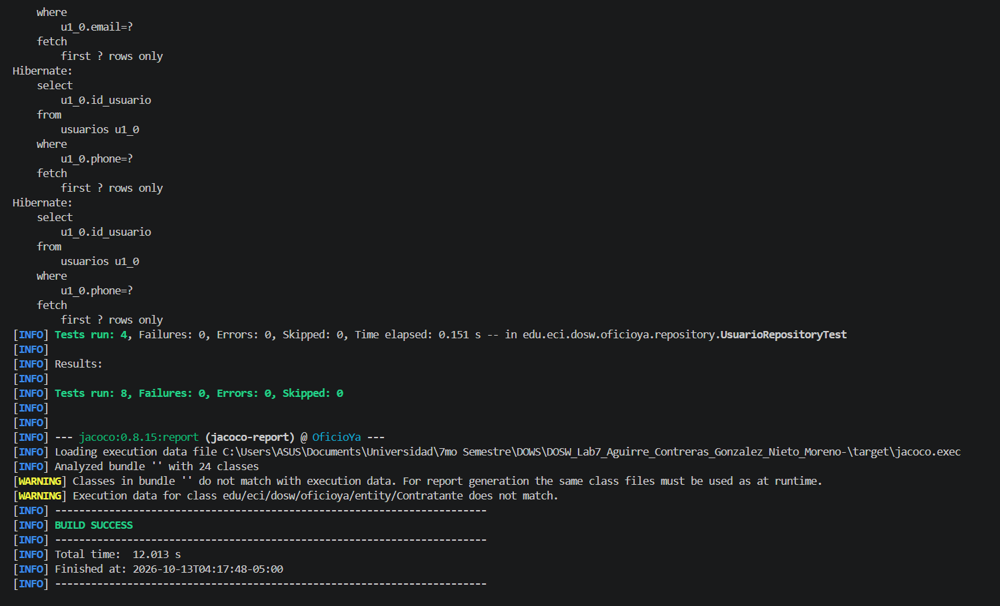
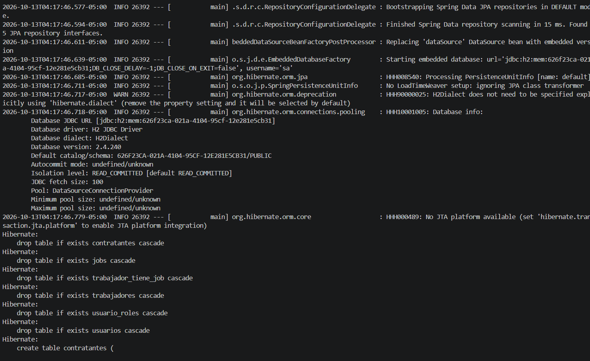

## Entidades seleccionadas para persistencia (Laboratorio 7)

Para esta entrega se seleccionaron cuatro entidades del dominio de OficioYa
que cubren las funcionalidades de **autenticación** y **gestión de trabajadores (CRUD)**.

| Entidad | Funcionalidad | Justificación |
|---|---|---|
| `Usuario` | Autenticación | Entidad base con las credenciales de acceso (`username` y `password`) y los datos de contacto (`email`, `phone`, `full_name`). Tanto trabajadores como contratantes se autentican a través de ella. |
| `Trabajador` | Trabajadores (CRUD) | Perfil de oferta del servicio: disponibilidad (`status_available`), tarifa aproximada (`price_rate`), foto de perfil, promedio de reputación, estado de pausa y total de trabajos completados. Es la entidad central del CRUD. |
| `Contratante` | Autenticación / perfiles | Perfil de demanda del servicio, con su foto de perfil. Hereda las credenciales de `Usuario`, por lo que también se autentica con usuario y contraseña. |
| `Job` | Trabajadores (CRUD) | Catálogo de oficios (nombre y estado activo). Clasifica a los trabajadores y es la base de la búsqueda por oficio. |

### Relaciones

| Relación | Cardinalidad | Implementación JPA |
|---|---|---|
| `Usuario` → `Trabajador` | Generalización | `@Inheritance(strategy = JOINED)` con `@PrimaryKeyJoinColumn(name = "id_trabajador")` |
| `Usuario` → `Contratante` | Generalización | `@Inheritance(strategy = JOINED)` con `@PrimaryKeyJoinColumn(name = "id_contratante")` |
| `Trabajador` ↔ `Job` | N:M | Tabla intermedia `trabajador_tiene_job` con clave compuesta (`id_trabajador`, `id_job`) y el atributo `es_principal`, que distingue el oficio principal de los secundarios |

### Decisiones de diseño

- **Herencia de tablas por unión (`JOINED`):** `Usuario` guarda los datos comunes y
  `Trabajador` y `Contratante` guardan solo sus atributos propios. Así se evitan columnas
  nulas y cada perfil comparte el mismo identificador del usuario.
- **Identificadores:** todos los ids son de tipo `Long`, autogenerados e incrementales
  (`GenerationType.IDENTITY`), según la regla de negocio del laboratorio.
- **Oficio principal y secundarios:** una sola tabla intermedia con la columna
  `es_principal` evita duplicar la relación y permite que un trabajador tenga varios oficios.
- **Contraseña:** por alcance y tiempo del proyecto, se almacena como `VARCHAR(12)`
  y no se maneja cifrado en esta entrega, según lo acordado con la docente.
- **Fotos de perfil:** se guardan como `byte[]` (`bytea` en PostgreSQL) en los perfiles.
- **Privacidad:** el correo y el teléfono se almacenan en `Usuario`, pero no se exponen
  en los modelos públicos; solo son de uso de la administración del sistema.
- Las demás entidades del diagrama (solicitudes, reputación, notificaciones, penalizaciones,
  zonas de cobertura y categorías especiales) se persistirán en siguientes iteraciones.

## PARTE 14 - Verificacion de las pruebas con uso de H2

*Figura 1. Ejecución de `mvn test` con todas las pruebas aprobadas*

*Figura 2. uso de H2 para la ejecucion de las pruebas*

## Bibliografia

Docker, Inc. (s. f.). postgres [Imagen oficial de Docker]. Docker Hub. https://hub.docker.com/_/postgres

H2 Database Engine. (s. f.). Features. http://www.h2database.com/html/features.html

Anthropic. (2026, 13 de octubre). Claude Sonnet 5.5 [Modelo de lenguaje de gran tamaño]. https://claude.ai

HowToDoInJava. (s. f.). Spring Boot @DataJpaTest. https://howtodoinjava.com/spring-boot2/testing/datajpatest-annotation

MapStruct. (s. f.). MapStruct 1.6 reference guide. https://mapstruct.org/documentation/1.6/reference/html

OpenAI. (2026). ChatGPT ([MODELO, p. ej. GPT-5]) [Modelo de lenguaje de gran tamaño]. https://chatgpt.com
